<p align="center">
  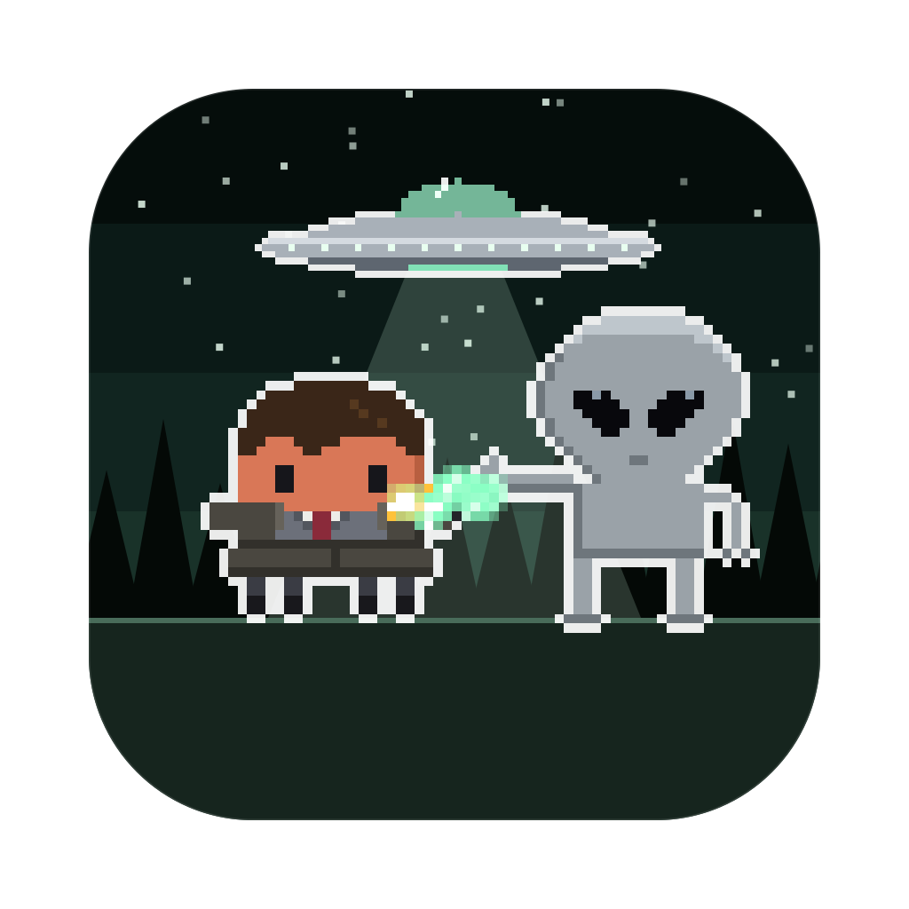
</p>

<h1 align="center">The Clawd Files</h1>

<p align="center">
  <b>Your AI coding sessions, as a pixel-art paranormal investigation on your desktop.</b><br>
  Every session is an agent, a conspirator or a monster of the week, every subagent joins in, and they fight while they work.
</p>

<p align="center">
  <a href="LICENSE"></a>
  
  
  
  <a href="https://github.com/rodclemen/clawd-clash"></a>
</p>

https://github.com/user-attachments/assets/d7e07f3a-4abc-454a-a2bc-3a4f3c150738

<p align="center"><sub>🔊 <b>Click the speaker in the player for sound</b>: GitHub starts videos muted. Full 1080p version: <a href="promo/the-clawd-files-promo.mp4">promo/the-clawd-files-promo.mp4</a></sub></p>

> **The Clawd Files is a universe of [Clawd Clash](https://github.com/rodclemen/clawd-clash).** Same crew, same fights, more universes to switch to. This page shows off The Clawd Files universe; see [Get it](#get-it) to install.

<p align="center">
  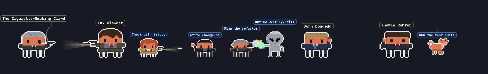
</p>

---

## Contents

- [What it is](#what-it-is)
- [The Clawd Files universe](#the-clawd-files-universe)
- [The cast](#the-cast)
- [Window mode](#window-mode)
- [Screen saver](#screen-saver)
- [Get it](#get-it)
- [More universes](#more-universes)
- [What's new](#whats-new)

## What it is

You run Claude Code in three terminals. One is thinking, one is waiting for your permission, one finished ten minutes ago and you didn't notice. You alt-tab around to find out.

**Clawd Clash tells you at a glance, without switching windows.** Every session becomes a character in a pixel-art investigation of the unexplained, along the bottom of your screen or in a window of its own: Claude Code's, and those of the other AIs and harnesses Clawd Clash supports ([the full list](https://github.com/rodclemen/clawd-clash#supported-ais-and-harnesses)).

- 🔦 **Working?** Your Claude draws its sidearm, flashlight beam cutting ahead into the dark (or rakes with a claw, or sends out the Black Oil).
- 💭 **Thinking?** A thought bubble.
- ❗ **Needs you?** A red `!`, and if you ignore it for a minute, it starts jumping up and down. It keeps asking until you answer; press Esc instead and it stands down.
- 😴 **Done and idle?** It stops fighting and passes the time with habits of its own: Fox Clawder cracks sunflower seeds and points at the saucer blinking over his head, Dana Scrawly holds up her badge, Skinnard rubs his eyes, the Cigarette-Smoking Clawd blows smoke rings, Eugene Clawms squeezes into a vent, the Great Mutato eats a sandwich, and the Bounty Hunter shifts into Scrawly and back. After a couple of minutes it sits down; after five it's asleep (zZz).
- 🕵️ **Spawned subagents?** Special agents walk in one by one, each labelled with what it's doing, and leave in an unmarked sedan when they finish.
- 🔍 **Hover** any character for the details: status, how long, the tool it's running, your last prompt.
- 🖱️ **Click** any of them to jump straight to that session's terminal or editor tab.

No dashboard to open, no tab to check. It's just… there. Watching.

## The Clawd Files universe

Run two Claudes and they square off. Every character is Clawd (Claude Code's little pixel mascot) in costume, and the fights follow the weapons:

| Matchup | What happens |
|---|---|
| a ray (the Grey's, the Black Oil's, the Faceless Rebel's) vs a gun | the gunner gets hit |
| a ray vs a blade, claws or fists | the blade catches the beam |
| a gun vs a blade, claws or fists | shots fly, and each one gets knocked away into the sky (and glances off the super soldiers) |
| blade, claws or fists vs the same | they close in and fight it out |
| gun vs gun | a proper shoot-out: they duck and the bullets collide mid-air |
| odd one out | cheers the others on |

The FBI carries sidearms, and their flashlights beam out ahead of them in a fight. The Syndicate fights dirty, with a pistol drawn from under a brandy glass or a case file rolled into a baton.

**Arch-enemies face off first.** Whenever a pair is on stage together, everyone else shuffles aside so the two of them can have it out: Fox Clawder and the Cigarette-Smoking Clawd, Scrawly and Eugene Clawms, Skinnard and Clawcek, Doggedd and Knowle Rohrer, Mister X and the Bounty Hunter, Marita and the Black Oil, Gibson Prays and the Faceless Rebel, and more.

**Their own rides.** When an agent is done, nothing flies in for them. The FBI's unmarked sedan drives up along the street, its back door swings open, and they get in:

<p align="center">
  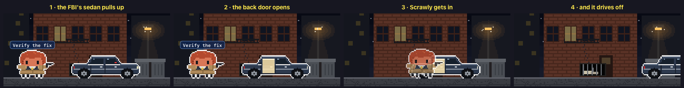
</p>

The Syndicate and its super soldiers leave in a black helicopter. The aliens walk up into a saucer's beam:

<p align="center">
  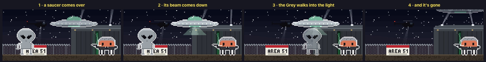
</p>

**Missing time.** When a Claude session playing one of the seven FBI agents compacts its context (when it runs out of room, or you type `/compact`), the agent is taken: a beam of light comes down, they rise up into it and out of sight, and a beat later they're set back down where they stood as MISSING TIME types itself out over their head. Same session, same face, some time gone.

<p align="center">
  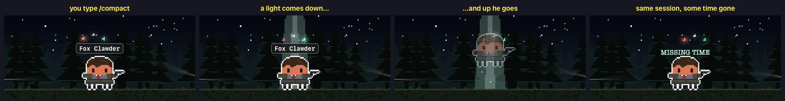
</p>

**Practice, The Clawd Files way.** A Claude working with nobody to fight works through practice sets: the agents put holes in a paper target at the FBI's firing range, Scrawly reads a case file, the Lone Gunclawds hack with green code scrolling over their heads, Skinnard does jumping jacks, and Queequeg chases his tail.

**Agents against the conspiracy.** Run Claude Code alongside another AI and they pick sides: Claude Code plays the FBI and their friends, the others the conspiracy and its monsters, and each one's agents fight for their own side. The outline colour round each character tells you which AI it belongs to.

## The cast

46 villains and 35 heroes (plus one rare guest), any of whom can be a session (drawn large) or an agent (drawn small).

**The FBI and friends**: Fox Clawder (sunflower seeds, *"I want to believe"*), Dana Scrawly (the badge), A.D. Walter Skinnard (rubs his eyes), John Doggedd, Monica Reyez, Agent Einstine, Agent Millar, the Lone Gunclawds (Bytes, Frohack and Lanky), Jimmy Bondd, Yves Harlowe, Deep Clawt, Mister X (tapes an X on a window), Marita Covarrubyass, Gibson Prays, Samantha Clawder, Melissa, Margaret and Teena, Jeffrey Spendr (shreds a file), Shannon McMahawk (lifts a car door), Max Fenig, Agent Pendrill, Arthur Dales (hits a home run), Clyde Bruckclaw and his kewpie doll, Jose Chung (at his typewriter), Leyla Harriclaw (knows every case by heart), Frank Blackclaw (sees things), Tad O'Clawley (goes live), Dr. Blockclaw, the Conundrum (swallows a goldfish), Sheriff Hartwell, Queequeg and Daggoo the goldfish. And now and then HEM turns up in a trench coat with a flashlight.

**The conspiracy and the monsters**: the Cigarette-Smoking Clawd (smoke rings), Alex Clawcek, the Well-Manicured Clawd, the First Elder, Diana Fowlclaw, Deputy Director Kersh, the Toothpick Man, Strughold, A.D. Follmer, Bill Clawder, the Crew-Cut Man, the Colonist, Duffy Haskell, Lord Kinbote, the Alien Bounty Hunter (shifts into Scrawly), the Black Oil, the Grey, the Faceless Rebel, Knowle Rohrer and Billy Miles (super soldiers), Eugene Clawms (squeezes into a vent), the Flukeman, the Pusher, the Jersey Devil, Leonard Betts, the Great Mutato (and his sandwich), the Wendigo, Mr. Chuckleteeth, Eve 6, Virgil Incanto, the Chupacabra, Big Blue, Tithonus (his camera), Cecil L'ively (fire), Luther Lee Boggs, Eddie Van Blundht, Ronnie Strickland (and his pizza), Guy Mann, the Trashman, the Tulpa, the Mothmen, the Rain King (frogs) and the Teliko. A killer bee, the Robo-Roach and a flukeworm only ever turn up as agents.

<p align="center">
  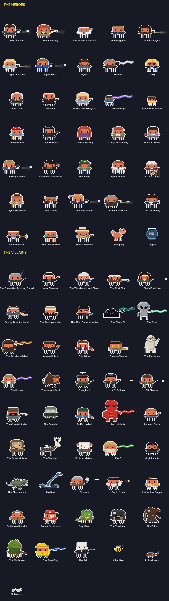
</p>

## Window mode

Clawd Clash opens in a window by default (switch to the desktop from the menu). The whole crew stands in a scene, and every session gets a card: its project, what it's doing right now, your last prompt, its last reply, and its agents in a little tree underneath. In The Clawd Files the place types itself in along the top, the way every scene in the show opens.

<p align="center">
  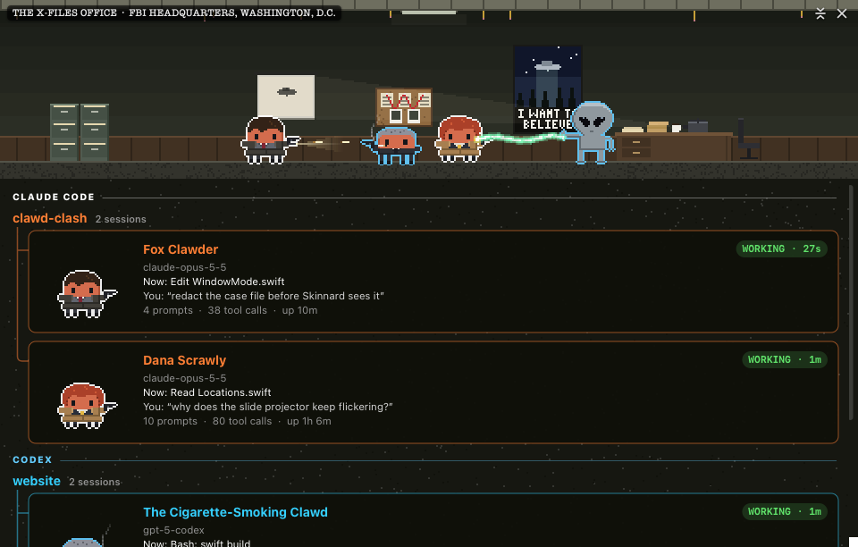
</p>

The scene is set **where the first session's character belongs**: the Syndicate's club for the Cigarette-Smoking Clawd, Area 51 for the Black Oil, the sewers of Newark for the Flukeman, Tooms's apartment block for Eugene Clawms, the Lone Gunclawds' den for Bytes, Frohack and Lanky:

<p align="center">
  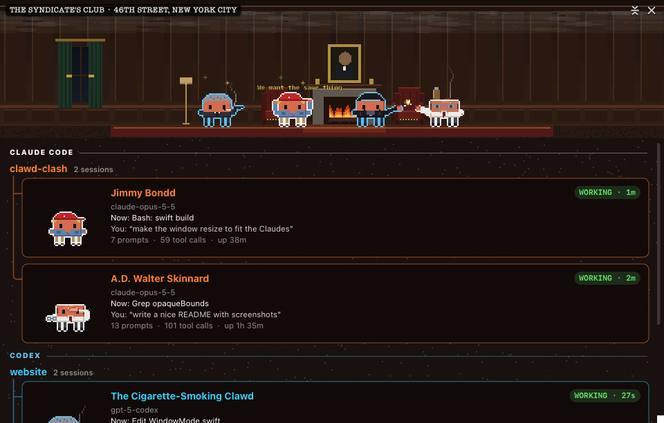
</p>

20 hand-built places, each with its own little animation: the slide projector flickers in the X-Files office; rain runs down Skinnard's window; the Gunclawds' monitors scroll; a fire crackles in the Syndicate's club; searchlights sweep over Area 51; the ship rises out of the Antarctic ice; the quarantine railcar's bomb counts down; the bee domes glow in the cornfield; Big Blue surfaces on Lake Okobogee; the Mutato's farm stays in black and white.

<p align="center">
  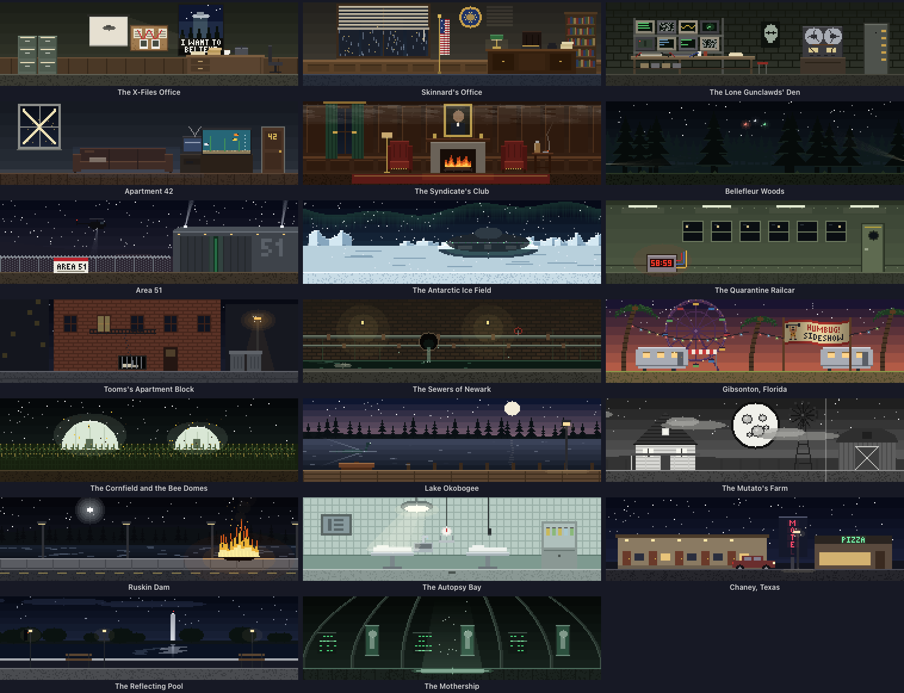
</p>

When the scene moves somewhere new, something slightly unnatural happens to it, the way the show does it: the Black Oil creeps up the walls and swallows the place; a huge eye blinks with the old place in its pupil; the place is filed away as a photo under redacted pages and a TOP SECRET stamp; an old TV loses sync; a saucer's beam washes everything out; two flashlights cross in the dark; cigarette smoke fills the room; a spy satellite pulls back to a map and dives on the new place; the picture warps into a line. And now and then you get the whole opening titles. Each comes up more often with its own people on screen.

<p align="center">
  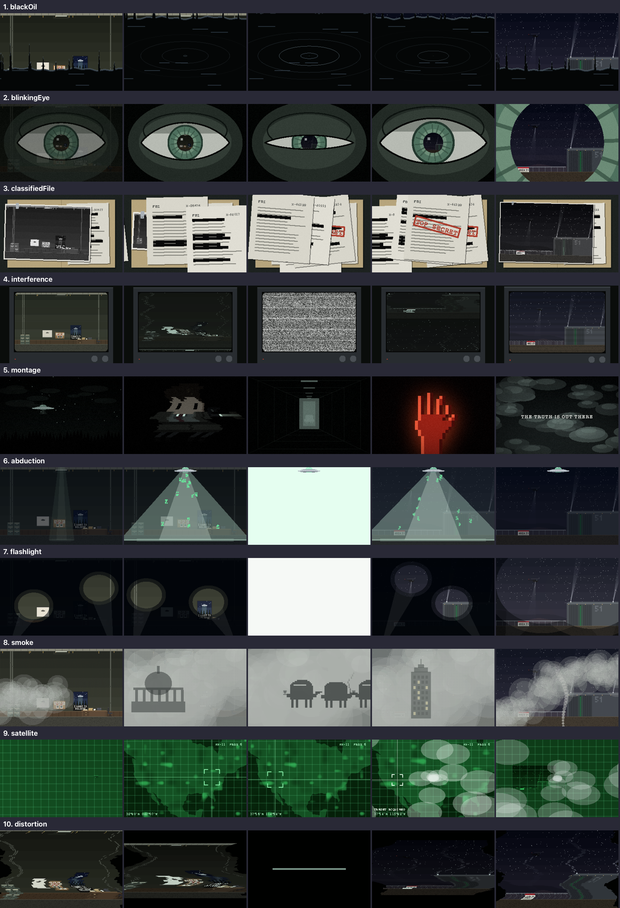
</p>

## Screen saver

<p align="center">
  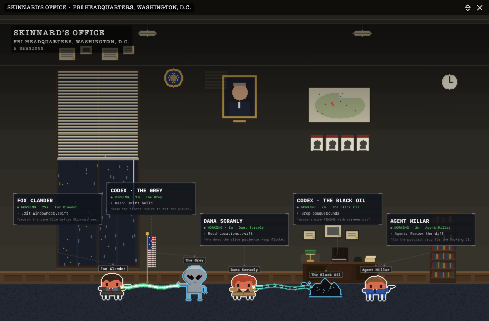
</p>

Clawd Clash comes with a screen saver: the place at full screen and the crew fighting across its floor. Every Claude and agent wears a name tag, each session has a card floating above the crew, a clock sits in the corner, and what happened lately crawls along the bottom. Every 10 minutes it travels somewhere new with one of the transitions above, and the new place types itself in. When there's nothing much to watch, it puts on a show instead: a random crew squaring off, agents against the conspiracy. It even shows your sessions with the app closed. Pick **The Clawd Files** in the screen saver's **Options…** in System Settings.

The window can show the same view, and **Random** location moves the window somewhere new every 10 minutes, the same way.

## Get it

The Clawd Files is part of **[Clawd Clash](https://github.com/rodclemen/clawd-clash)**, one app with multiple universes. It needs macOS 13+ and at least one of the [AIs and harnesses it supports](https://github.com/rodclemen/clawd-clash#supported-ais-and-harnesses).

It comes with Clawd Clash 3.3.0 and later. With Homebrew:

```sh
brew tap rodclemen/tap
brew trust rodclemen/tap      # newer Homebrew asks you to trust a third-party tap once
brew install --cask clawd-clash
```

Then pick **Settings → Universe → The Clawd Files** (already have Clawd Clash? `brew upgrade --cask clawd-clash`). Or download the zip from [Clawd Clash's releases](https://github.com/rodclemen/clawd-clash/releases), unzip it and drag **Clawd Clash** to Applications.

Everything else (how it works, the settings, uninstalling, the source and contributing) lives in the **[Clawd Clash repo](https://github.com/rodclemen/clawd-clash)**.

## More universes

The Clawd Files is one of multiple universes. In **Settings → Universe** you can switch to **[Star Clawds](https://github.com/rodclemen/star-clawds)**, **[Marvelous Clawds](https://github.com/rodclemen/marvelous-clawds)**, **[Detective Clawds](https://github.com/rodclemen/detective-clawds)**, **[Doctor Clawd](https://github.com/rodclemen/doctor-clawd)** or **[Stevie Clawdberg](https://github.com/rodclemen/stevie-clawdberg)**, or pick **Random** to change universe on its own every so often. Switching recasts everyone on screen and moves the scene to one of the new universe's places. Or pick **Clawd Royale** to throw every cast into one scene, each character as themselves, in a new place from any universe every ten minutes.

## What's new

The highlights, in plain words: [CHANGELOG.md](CHANGELOG.md). The full history lives in Clawd Clash.

---

<p align="center"><sub>An independent parody fan project, not affiliated with or endorsed by 20th Television or the makers of The X-Files. Claude and Clawd belong to Anthropic.<br>Free to use: <a href="LICENSE">MIT licensed</a>.</sub></p>
